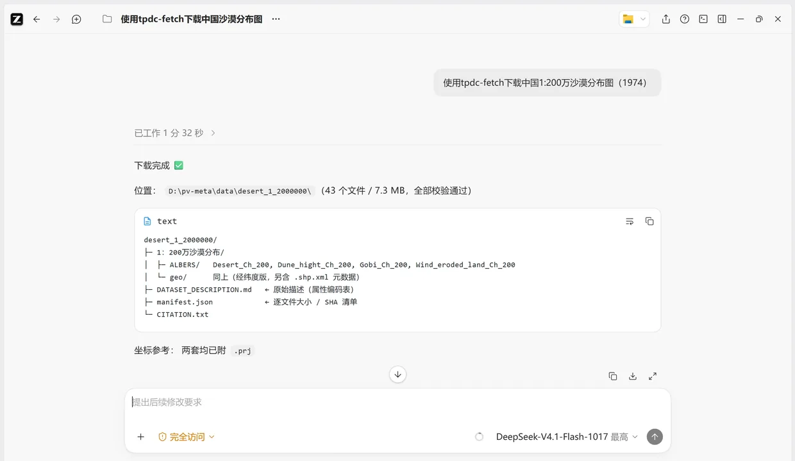
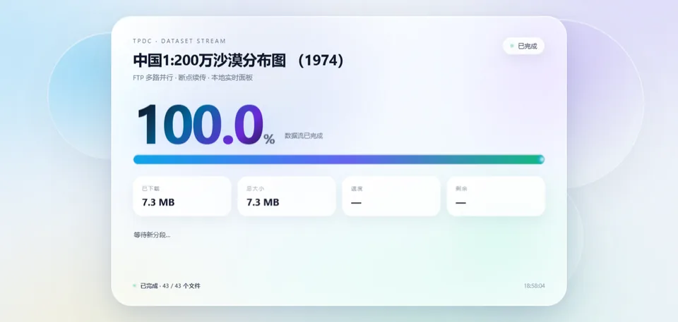

<div align="center">
  

  <a href="./LICENSE"></a>
  
  

  用自然语言获取 TPDC 科学数据的 AI Agent Skill。

  [这是什么](#这是什么) · [能做什么](#能做什么) · [开始使用](#开始使用) · [常见问题](#常见问题) · [使用边界](#使用边界)
</div>

## 这是什么

TPDC Fetch 是一个面向[国家青藏高原科学数据中心](https://data.tpdc.ac.cn)（TPDC）的 Skill：检索、筛选、查阅、下载数据集，一句话就能跑完，Claude Code、Codex、Cursor、ZCode、Qoder、WorkBuddy 等支持 Skill 的 AI Agent 均可直接调用。

**你不需要知道数据集 ID，也不需要记 FTP 地址、端口和账号。**

## 能做什么

| 你想要 | 你可以这样说 | 它会做什么 |
|---|---|---|
| 找数据 | “搜 TPDC 的沙漠分布数据” | 返回 ID、访问级别、作者、DOI |
| 判断能不能下 | “这个数据集我的账号能下吗？” | `status` 三段探测（无登录→登录→FTP），输出结论与依据 |
| 看说明 | “这个数据集的投影是什么？” | 读 `description`，原样输出，不猜 datum |
| 下开放数据 | “把 `122c9ac2...` 下到 `./data`” | 免登录 FTP，分段、续传、进度条 |
| 下登录数据 | “用我的 Cookie 下这个数据集” | `--cookie` 或 `TPDC_COOKIE`；会话 Cookie 读不到时用 `--token` / `TPDC_TOKEN` |
| 引用 | “给我这个数据集的 BibTeX” | `CITATION.txt` / BibTeX |

## 开始使用

**一句话安装到 Agent：**

> 帮我安装这个skill：https://github.com/Rimagination/tpdc-fetch

**查找数据：**

> 使用tpdc-fetch检索一下有多少跟沙漠有关的数据集？

**下载数据：**

> 使用tpdc-fetch下载中国1:200万沙漠分布图（1974）

<a href="./assets/desert-download-result.webp"></a>

**显示进度条：**

> 显示tpdc-fetch下载任务实时面板

加 `--panel` 会起一块本机实时面板（只绑定 127.0.0.1），分段进度、已传文件数、写入速度一目了然；终端进度条照常（`--no-progress` 可关闭）。已经在跑的下载也能单独监视：`python scripts/progress_panel.py --dir ./data`：

<a href="./assets/progress-panel.webp"></a>

也可以直接用命令行（Python 3.8+，无第三方依赖）：

```bash
python scripts/tpdc.py search "沙漠" --limit 10
python scripts/tpdc.py meta <metadataId>
python scripts/tpdc.py download <metadataId> --out ./data
```

常用参数：`--workers 4`、`--include/--exclude`、`--metadata-only`、`--dry-run`、`--sha256`。

## 你会得到什么

- `DATASET_DESCRIPTION.md` — TPDC 原始数据说明；
- `manifest.json` — ID、DOI、访问级别、逐文件大小 / SHA256；
- `CITATION.txt` — 可直接粘贴的引用。

## 访问权限

| 级别 | 含义 | 工具怎么做 |
|---|---|---|
| **A** | 开放，免登录 | 直接拿 FTP 账号下载 |
| **B** | 需要登录 | 用浏览器 Cookie：`--cookie` 或 `TPDC_COOKIE`；Cookie 是 httpOnly 时改用 Bearer 令牌：`--token` 或 `TPDC_TOKEN` |
| **C** | 需要申请 | 只给页面链接，不绕过申请 |

标签不等于实际权限：有的 B 类数据集登录后仍会返回「未查询到对应 FTP 账户」——那说明还需要单独申请，登录本身不够；也有的 C 类数据集对已授权账号可以直接下。以接口实际返回为准，工具会把服务端原因原样报出来。拿不准就用 `status <id>` 探测一遍，它会区分「无权限」和「服务端瞬时错误」这两种看起来一样的东西。

## 常见问题

**为什么慢？** TPDC 白天限速，单连接约 100 KB/s，4 路约 0.4 MB/s；02:00–10:00 更快。

**为什么只有 4 路？** 每 IP 最多 5 个连接，第 6 个会 `421`。

**为什么没有 `.prj`？** 数据集本身没带；说明只写“大地坐标系”，没有 datum。工具不猜。

**中断了怎么办？** 重跑同一条 `download`，完成的跳过，`.seg` 续传。

## 使用边界

非官方工具，与 TPDC 无隶属关系；用的是网页内部接口，可能随时变更；不绕过登录/申请。凭据（Cookie / 令牌）只在进程内存里使用，不落盘、不进日志，`--token-file` / `--cookie-file` 可避免进入 shell 历史；实时面板只绑定 127.0.0.1，不提供文件内容。数据版权与引用以 TPDC 页面为准。

## 许可证

MIT · [LICENSE](LICENSE) · 详细用法见 [SKILL.md](SKILL.md)
